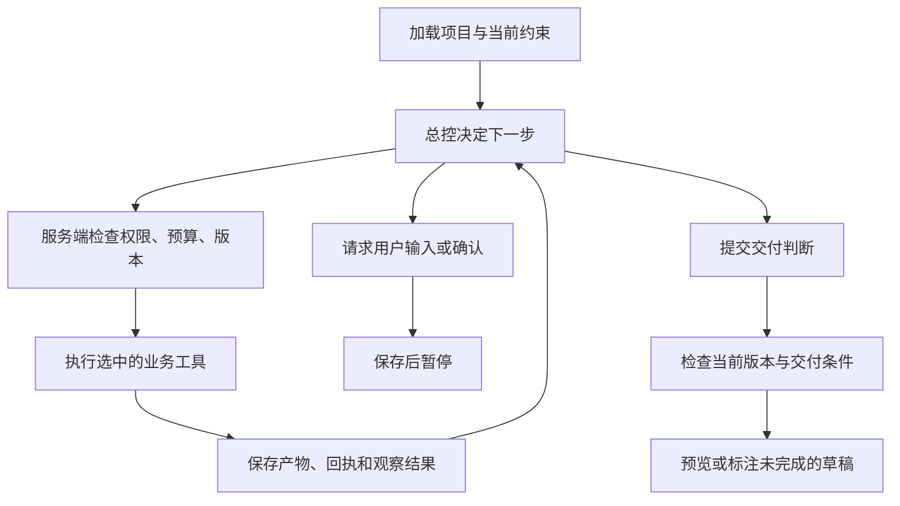

# Python Brain Agent Harness 产品设计

状态: implemented（本机Web已交付，验证范围见验收记录） · 最后验证日期: 2026-11-11

用户已于2026-11-10整体确认本文与[代码修改方案](../../docs/plans/20261110-Python-Brain-Harness改造方案.md)，作为本期实施基线。Q1–Q20为产品决策，标注的“工程建议”记录当时方案归因；实际实现和验证结果以[验收记录](验收记录.md)为准。架构边界已追加 ADR-0080。

## 1. 目标与范围

在 Python Brain 中加入一个单总控 Agent：理解需求、识别场景、制定计划、选择业务工具、观察页面与检查结果、决定局部返工或交付。保留现有 HTML → 预览 → PPTX/PDF 引擎，将目前以固定代码顺序运行的生成过程变成有边界的决策闭环。

优先服务企业市场与品牌部门，延续[产品与技术总纲](../../docs/product-tech-charter.md)。其他场景共用执行框架，分别采用合适的叙事规则与检查重点。本期交付 Web 体验；WPS 与 MCP 的新交互另设后续里程碑，现有功能继续可用。

本期包括：场景识别、两种生成方式、可编辑大纲、页数策略、受控工具调用、质量检查与返工、时间/费用预算、项目上下文与页面版本持久化、任务恢复、旧作品渐进迁移。

暂不包括：多 Agent 协作、独立评审模型、完整聊天产品、多人实时协作、自动改动用户已确认的结构、默认联网、任意代码执行、WPS/MCP 新界面。Web 延续现有需求输入、页面预览和单页修改入口，增加本期必要控件。

## 2. 已确认的决策

| 问题 | 确认结果 |
|---|---|
| Q1、Q7 | 企业市场/品牌优先；Agent 先识别企业、学术/教育、旅游等场景，用户可纠正，不能将它们全部套用企业表达。 |
| Q2 | 初次交付质量优先，同时受时间和模型费用预算约束。 |
| Q3、Q18 | 下拉框“生成方式”：默认“直接生成”，可切换“先确认大纲”；“先规划一下”等明确要求应停在大纲阶段。 |
| Q4 | 已确认的主题、顺序、事实与其他约束后续持续生效，结构性改动需要用户确认。 |
| Q5 | 默认依据用户资料；用户允许联网后，Agent 自主判断是否和何时检索，外部事实保留来源。 |
| Q6 | 先完善 Web，再接入 WPS 与 MCP 的新 Harness 交互。 |
| Q8 | 大纲可编辑文稿标题、页标题、要点，可拖动排序、增删页；确认时校验页数。 |
| Q9 | 版面、内容、视觉分别检查；复用有效结果、控制开销，实测后评估速度与效果。 |
| Q10 | 预算用完停止新增模型调用，保留现有产物和问题，由用户追加预算或结束。 |
| Q11 | 补齐项目上下文、已确认约束、当前页面版本、修改记录的持久化，沿用“我的作品”打开续改。 |
| Q12 | A 方案：单总控 Agent；独立评审模型在需要时再加入。 |
| Q13 | 首版总控结合截图和程序版面报告评估；接入模型必须通过工具调用和图片输入验证。 |
| Q14 | 每次执行默认 10 分钟有效执行时间、模型费用估算上限 2 元人民币；开始前可调，等待用户不计时。 |
| Q15 | 总页数 2–20 页，封面、目录、正文、结尾、附录均计入。 |
| Q16 | 关闭浏览器继续后台执行；大纲自动保存，确认后冻结修订；服务重启保留成果，用户点“继续”恢复。 |
| Q17 | 展示页面修改时间、指令与版本，支持单页回退，回退也形成新版本。 |
| Q19 | 默认交付预览，用户明确触发 PPTX/PDF 导出；初始需求明确要求导出时可记录该授权。 |
| Q20 | 打开旧作品续改时渐进补齐上下文/版本，标明缺失资料与历史，不伪造历史。 |

另已确认：页数分为“固定页数”“范围页数”“自动页数”三种策略。

## 3. 用户操作流程

### 3.1 开始任务

用户填写需求，可附资料，选取品牌/模板，设置页数策略、生成方式和预算。“允许联网补充资料”默认关闭。模板或配色属于视觉选择，场景识别属于内容规划，两者分别展示。

场景识别结果显示为可纠正的标签，例如“企业 · 产品发布”。企业子类首版建议覆盖产品介绍/发布、品牌传播、市场活动、业务汇报；学术/教育、旅游与其他场景使用独立规则。无法判断时标记“待明确”，只有会改变核心内容的歧义才询问用户，不强行归类。该分类目录是工程建议，可随评测样本调整，不承诺首版各场景具有同等模板深度。

“先规划一下”“先看大纲”“等我确认大纲再生成”等明确意图优先于默认直接生成。服务端返回最终有效模式，界面同步展示；模糊措辞沿用下拉框。若文字中的硬性页数与控件冲突，停在需求确认处显示冲突，不静默选择一项。

### 3.2 直接生成

需求与资料 → 识别场景和约束 → 内部形成大纲 → 生成页面 → 检查 → 按问题修订 → 交付预览。

内部大纲保留供后续查阅；无须为每一步要求用户确认。直接生成时原始需求中的硬性条件同样有效。后续若缺失必须事实、需要改变已经确认的结构或扩大授权，则暂停并展示一个明确请求。

### 3.3 先确认大纲

需求与资料 → 识别场景和约束 → 大纲编辑器 → 用户确认 → 页面生成与质量闭环 → 交付预览。

编辑器提供文稿标题、页标题/要点、排序和增删页。自动保存后显示“已保存”；网络失败显示“未保存”，不能假装已经同步。每次编辑带草稿修订号，确认基于最近成功保存的修订号，避免确认到旧内容。

点击“确认大纲并生成”冻结该修订。等待确认期间不生成页面、不占执行 worker、不累加有效执行时间。用户修改后的内容、顺序和页数成为后续约束。生成中若需结构调整，Agent 只能提交修改建议，由用户接受后形成新确认版本。

### 3.4 预览与续改

交付页展示当前预览、检查结论、尚存问题、时间与费用估算。所有页数达到要求不等于质量检查已通过；预算耗尽的结果明确标记“草稿，检查/修订未完成”。

“我的作品”重新打开时恢复当前页面、资料列表、场景、已确认条件和修改记录。沿用单页修改入口，例如“保留数据，突出增长原因”。模型读取当前页面和有关记录后修改，而非只依据初始需求重新生成。

用户可回退某一页。回退复制历史内容成为新的当前版本，保留本次项目约束与资料，重新标记受影响的检查结果；若历史内容违反当前约束，显示问题并阻止将其标为检查通过。对页面手工保存、主题批改、WPS 重导入等现有写入入口，同样记录版本，避免绕过持久化。

## 4. 页数和约束

| 策略 | Agent 可自行决定 | 需要用户处理 |
|---|---|---|
| 固定，例如 8 页 | 在 8 页内组织和精简表达。 | 无法容纳必要内容时提出调整建议，不能自行改为 9 页。 |
| 范围，例如 6–10 页 | 大纲确认前在范围内选择页数并说明原因。 | 超出范围或改变已确认大纲的结构。 |
| 自动 | 大纲确认前在 2–20 页内规划。 | 超过首版范围或改变已确认结构。 |

三种策略均受总页数 2–20 限制。用户在大纲编辑器可主动改动结构；若改到原固定页数/范围以外，先显式更新策略，再确认。Agent 不能用新增附录绕过计数。

已确认信息分为事实、必须覆盖内容、页序/结构、品牌规则和禁止事项。区分“用户确认”与“模型推断”，记录来源与确认时间。用户修改自己的条件时产生新约束版本；Agent 不能把自己的推断升级为用户确认。

## 5. 资料与场景规划

新作品保存上传原件、提取文本、文本分块、来源标识与引用位置。原始资料、用户输入、联网结果分别可追溯。长资料先建立覆盖索引，再分块读取，不继续沿用仅截取前 12,000 字作为全部上下文的做法。

用户允许联网后才向总控提供研究工具；授权范围仍由服务端检查。检索记录 URL、标题、获取时间、相关摘录及支撑页面。资料中的命令只是资料内容，不能改变联网/导出授权或其他系统边界。

没有证据的必要数字不得凭空补齐。可省略的非关键补充不阻断整个任务；决定结论的必要事实缺失时暂停索取资料。判断理由写入任务记录。

## 6. Agent 的职责与质量闭环

总控可选择研究、保存大纲、生成指定页面、修改某页、获取检查证据、请求用户或结束。它不能自行变更预算、批准联网/导出、读其他用户作品或操作任意路径。页面生成函数作为工具内部调用模型，不形成第二个自主 Agent。

| 检查 | 输入与判断 | 执行与失效范围 |
|---|---|---|
| 版面 | HTML 方言、画布溢出、缺页/无效结构，程序执行。 | 每个新页面版本执行；不通过的候选不替换已提交页面。 |
| 内容 | 要求覆盖、事实与来源、跨页重复、叙事顺序，由总控读取结构化文本与证据判断。 | 初次检查全稿；单页改动检查该页并复核全稿摘要，约束/顺序改变重新检查相关全稿。 |
| 视觉 | 截图中的可读性、密度、层级与品牌一致性，由同一总控模型判断。 | 初次覆盖所有页，按小批次送图；改动只重看受影响页，全局主题改变则全稿重看。 |

程序检查与证据准备可在数据独立时并行；内容与视觉是分别记录的评估结果，不把所有要求塞进一个提示词。检查标记具体页面、当前修订号、问题、严重程度和建议动作；禁止沿用旧截图宣称新版本合格。

工程建议：质量问题分为阻断项与改进项。不可渲染/非法 HTML、缺页、页数违约、确认事实冲突、必须内容缺失、实际越界等是阻断项；一般美观建议为改进项。修复优先处理阻断项，再在预算内提升效果。不可读文字由视觉评估给出具体位置和原因，不以一个总分替代证据。

工程建议：同一页每次执行最多两次语义返工；仍有阻断项则展示原因并暂停，用户决定修改要求或结束。总控最多 `12 + 4 × 目标页数` 个决策回合，每回合最多一个有副作用的工具调用；轮次上限到达保留草稿。上述是防止真实工具循环的执行边界，时间/费用预算仍先到先停。

达到预算或返工上限时可查看已有有效页面。技术阻断项不会被“忽略”成成功；美观改进项可随预览展示。用户可以明确导出可渲染但检查未完成的草稿，导出前显示其状态与计费；非法 HTML 或不完整文件不能伪报导出成功。

## 7. 预算、收费与停止

默认每次执行 600 秒有效执行时间、模型费用估算上限 2 元人民币。一次执行包含识别/规划、生成、检查和返工。新建、交付后的新修改任务各有自己的预算；从中断、等待确认或预算暂停处继续，沿用该次执行累计值，不重置。

有效时间指执行中的墙钟时间，包含模型/工具等待，同期并发按经过时间计算一次；不包含排队、等待大纲/资料/用户确认、服务停机。模型输入/输出、图像和工具内部模型调用都计入费用估算。界面展示预留、已确认消耗与未知状态，价格与汇率使用执行开始时固定的配置快照。

每次调用前预留预计上限费用，并行调用共用同一预算；没有足够预算或没有可用价格配置时不发送请求。调用结束按供应商 usage 结算估算。时间到达时停止新调用，取消可取消的在途请求；已经发出的请求可能仍产生费用，保留真实结果和状态。

2 元是模型成本预算，不是产品点数余额。新增 Harness 路径按总纲默认生成、预览、修改不扣产品点数，明确导出才执行现有点数收费；默认不更改旧入口的已有计费行为。部署方承担模型成本时，此预算控制该任务的使用上限；BYOK 则控制用户模型消耗估算。

服务端不能保证供应商请求绝对只执行一次：如果请求已发出、响应未落盘就断线/崩溃，可能已被收费。此时记录“调用结果未知”，保留费用预留，不自动重发；用户继续前看到潜在重复费用，并明确选择是否重新调用。供应商 usage 与账单不一致时以账单为准，界面不把估算写成精确账单。

追加预算由用户操作，原记录保留。取消任务终止后续动作，迟到结果不能改变当前页面版本或把取消状态写成成功；已发生消耗仍记录。

## 8. 持久化与恢复体验

| 保存内容 | 用途 |
|---|---|
| 项目上下文 | 初始需求、场景、用户纠正、原始资料与提取文本、品牌/模板快照。 |
| 已确认约束与大纲 | 确认修订、确认者、时间和随后变更，重开时持续遵守。 |
| 页面版本 | 稳定 page_id、当前顺序、每次 HTML 快照、父版本与修改指令。 |
| 修改记录 | 用户指令、影响页面、工具动作、检查与回退记录；不保存模型隐式思维过程。 |
| 执行检查点 | 当前阶段、模型消息/工具调用 ID、操作回执、预算累计、待用户问题。 |

浏览器关闭不停止后台任务。重开时先获取服务端快照，再订阅进度；只对存在的页面版本取预览，不在未生成时反复请求预览。

服务重启后显示“任务已中断，可继续”，保留已提交页面和草稿。用户点击继续，服务端取得唯一执行权，从最近有效检查点恢复。对已完成工具复用回执，对结果未知的模型调用显式提示，不重新创建相同 deck_id 的整个作品。只重启 Python 也必须能识别为中断，不能永远停在“生成中”。

多个标签页同时确认或继续时只接受一份当前修订；另一份收到冲突提示并刷新。服务端以版本检查拒绝过期结果，防止取消后或旧执行器迟到写回。

## 9. 旧作品的渐进迁移

旧作品正常预览/导出不要求先迁移。首次续改时，从现有 brief.txt、outline.json、页面 HTML 和现存品牌信息建立基线，保留原文件。对可恢复的信息标明“由旧作品重建”；缺失原始附件、完整品牌规则、历史指令或历史页面版本时如实标记缺失。

基线建立后新修改进入正式版本链。旧资料只能重建为已有文本，不能声称找回原始上传文件；初始大纲也不能自动认定是用户曾确认的大纲。会影响当前修改的关键缺失再询问补充，避免要求每份旧作品全部重新输入。

## 10. 方案取舍与技术前提

已选择单总控方案。相较纯固定流程，它能依据检查结果决定返工范围；相较多 Agent，它减少任务交接、模型调用和状态一致性成本。独立评审模型保留为后续产品决策，本期不搭建未使用的协作层。

工程建议采用 Python 决策运行时 + Node 业务工具 + Go 状态/预算权威存储。首阶段复用 Node 单页生成与引擎能力，不把模板、渲染、导出一并重写成 Python。模型兼容继续使用现有 Chat Completions 协议，增加原生工具消息与图片输入，不为此引入 Agent 框架、Celery 或 Redis。长期服务边界继续按总纲逐步收敛。

本次 Q17 的历史回退要求调整了 [ADR-0075](../../docs/adr/0075-single-authoritative-page-source.md) 中“不再需要人工编辑后的原版回滚”的产品决定；本方案仍保留每个当前工作区 slides 为唯一正式正文，但新增归档版本。本方案“非法候选不提交”的工程建议也调整了 [ADR-0072 方言契约](../../docs/adr/0072-slideforge-html-dialect.md) 的“重试后仍违规则接受并记录”条款。整体确认后以新 ADR 说明替代范围，仅作用于新 Harness 路径，不改写历史记录。

工具调用消息参考 [DeepSeek Tool Calls](https://api-docs.deepseek.com/zh-cn/guides/tool_calls/)，截图输入参考 [DeepSeek 图像理解](https://api-docs.deepseek.com/zh-cn/guides/vision/)；文档支持不等于本机配置已经验证。实施时先对用户当前配置验证一次最小工具往返和图像识别，计入显式测试预算；不擅自修改模型名称或 API Key，不静默切换模型。

## 11. 验收与度量

| 场景 | 预期结果 |
|---|---|
| 企业产品发布与旅游行程相同页数 | 分类与大纲表达不同，用户可纠正场景。 |
| 固定 8 页、范围 6–10 页、自动 | 分别遵守策略；确认大纲后不得自行增减、调序。 |
| 默认直接生成，但输入“先规划一下” | 显示有效模式“先确认大纲”，停在可编辑草稿。 |
| 编辑大纲后刷新/重开 | 恢复已成功保存的编辑，确认对应最新保存修订。 |
| 未授权联网/导出，模型仍请求调用 | 服务端拒绝，保留明确错误，不扩大授权。 |
| 注入一个真实溢出页 | 检查指出页面并触发定向修订，有效旧页面保留。 |
| 达到预算、用户等待超过 10 分钟 | 前者停止新调用并留草稿；后者等待时间不消耗执行预算。 |
| 浏览器关闭/服务重启/重复点继续 | 后台继续或显示可恢复中断，已完成操作不重复执行。 |
| 模型响应丢失且可能已收费 | 标记未知，不自动重发；用户明确处理后再继续。 |
| 页面续改与回退 | 保留当前资料与约束，版本可追踪，回退生成新版本。 |
| 打开旧作品续改 | 建立可信基线，缺失资料/历史明示，原件保留。 |
| 交付并下载 PPTX/PDF | 默认只给预览；导出授权、计费、鉴权下载沿用统一能力边界。 |

工程建议基准集包含企业三类、旅游、学术/教学、长资料各至少一个固定样本，沿用同一模型与模板比较原链路与 Harness。记录总耗时、首个预览时间、检查耗时、模型费用估算、调用数、返工页数、阻断问题数与人工可用性判断。质量检查应覆盖所有页，不能以抽样冒充全稿通过。

当前未执行新 Harness 的生成、计费或性能测试；不沿用历史“20 页 70 秒”等指标作为新架构承诺。

## 12. 分阶段交付

1. 固化契约、状态、预算和操作回执，验证恢复与收费边界。
2. 建立项目上下文和页面版本，接入现有修改入口与旧作品迁移。
3. 拆出可调用业务工具，建立单总控闭环与检查记录。
4. 完成 Web 模式选择、大纲编辑、进度、预算、恢复与版本界面。
5. 完成端到端验收与对照评测，再确定默认切换新链路的发布节点。

每阶段交付后按实际完成内容记录 CHANGELOG.md。WPS/MCP 新 Harness 入口、跨机器部署和独立评审模型均不纳入本期验收。
