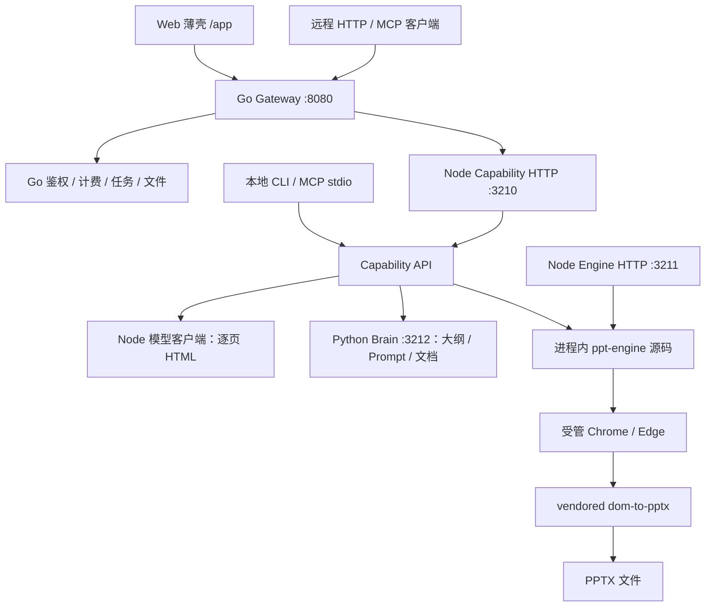

# SlideForge 项目架构与本地运行梳理

核对日期：2026-11-04。对象：`D:\SlideForge` 当前 checkout。后续已安装 Go／Python 依赖并完成四进程联调，最新启动命令见第 12 节。

本次检查覆盖仓库目录、现役 HTTP／CLI／MCP 入口、Capability、模型调用与提示词、跨服务协议、Go／Python 服务、引擎工作区与导出主干、依赖与构建脚本，以及相关测试和 ADR。模板、图片、字体、评测附件等作为资源检查，没有逐项人工审阅全部内容。下文区分实际代码、目标架构和本次验证结果。

## 1. 项目目前是什么

SlideForge 是 AI 演示文稿交付服务。用户给出需求和可选材料，系统组织大纲、调用模型生成每页 HTML、检查页面、提供预览与修改，再转换成 PPTX／PDF。

当前处于从独立 Node 服务向 Go／Node／Python 分工迁移的阶段。`npm run serve` 提供最小单 Node 路径；`npm run dev` 启动四个进程。两者都保留，不能把三语言目标架构视为已经完全落实。

从执行机制看，现役主线是代码编排的生成流水线：固定阶段、有限并发、校验反馈和重试。MCP 把这些能力提供给外部 AI 客户端。根服务没有使用 LangChain／LangGraph 一类框架来运行自主规划、任意选工具的通用 Agent；模型客户端主要是 Node `fetch` 和 Python `urllib`。

产品方向和约束以 [产品与技术总纲](D:/SlideForge/docs/product-tech-charter.md) 为准；运行行为需核对当前实现。

## 2. 当前真实运行拓扑



图中 Brain 在配置远程地址后使用；单 Node 模式使用本地提示词和文档提取实现。Gateway 的 readiness 会检查 3210、3211、3212。独立 Engine HTTP 已实现协议，但当前生成与导出仍由 Capability 进程内调用引擎，没有发现生产主链路通过 HTTP 委派给 3211。

| 进程／入口 | 端口／形式 | 当前职责 |
|---|---|---|
| `npm run serve` | 3210 | Web 页面、REST、远程 MCP、请求校验、任务编排和业务调用 |
| `npm run serve:gateway` | 8080 | 鉴权、计费、任务记录、SSE／取消／webhook、文件服务，其余请求代理到 3210 |
| `npm run serve:engine` | 3211 | 内部 HTML 校验、预览、PPTX／PDF 导出接口 |
| `npm run serve:brain` | 3212 | 大纲模型调用、页 Prompt、文档处理、图像差异、evals |
| `npm run generate -- ...` | 一次性 CLI | 直接调用 Capability 生成并导出 |
| `npm run mcp` | stdio | 向本地 AI 客户端暴露五个工具 |
| `npm run dev` | 上述四进程 | 同一终端启动、汇集日志、统一退出；入口是 8080/app |

注意：`npm --prefix executas/ppt-engine run start` 启动的是引擎原有模板服务，默认 3101。它与根目录的 `serve:engine` 3211 是不同入口。

关键源码：[启动器](D:/SlideForge/scripts/dev-services.mjs:1)、[HTTP 入口](D:/SlideForge/src/http/capabilityServer.ts:1)、[Go 路由](D:/SlideForge/services/gateway/internal/httpapi/server.go:105)、[Engine HTTP](D:/SlideForge/src/http/engineServer.ts:18)、[Brain](D:/SlideForge/services/brain/brain/app.py:1)。

## 3. 目录职责地图

| 目录 | 作用及阅读重点 |
|---|---|
| `src/contracts/` | TypeScript 内部 DTO、Zod 请求约束、错误结构和 deck_id；应保持纯契约 |
| `contracts/openapi/` | Go／Node／Python 跨服务协议；与 src/contracts 不是同一层 |
| `src/capabilities/` | 统一业务入口；deck.ts 包含创建、改页、回传、换肤、HTML 保存、预览和导出 |
| `src/http/` | 当前静态 HTML／JS Web 壳与两个 Node HTTP 服务；根 React／Vite 入口已退役 |
| `src/mcp/` | stdio／远程 MCP 共用的工具定义 |
| `src/server/` | 任务队列、任务持久化、HTTP 保护、导出幂等，以及远程 Brain／文件客户端 |
| `src/billing/` | 本地开发计费实现与调用 Go 计费接口的适配器 |
| `scripts/m0/` | 现役模型客户端、Prompt、HTML 组装、方言校验、版面测量和缩略图；目录名虽叫 m0，仍是运行主干 |
| `src/templates/` | 内置模板列表、参考页读取和确定性推荐 |
| `src/features/templates/presets/` | 共享模板 HTML／WebP 资产；不能随旧 React 代码一起删除 |
| `src/brand/` | 从 PPTX 主题提取颜色／字体、品牌存储及优化 |
| `src/documents/`、`src/research/` | 文档提取、PPTX 文本读取、联网检索与正文抓取 |
| `services/gateway/` | Go 网关，以及本地／PostgreSQL／S3 存储实现 |
| `services/brain/` | Python 大脑服务；当前 HTTP 基于标准库 ThreadingHTTPServer |
| `executas/ppt-engine/` | HTML 工作区、模板、浏览器渲染、PPTX／PDF 导出、任务状态机及保留的插件能力 |
| `third_party/dom-to-pptx/` | 仓库直接维护的权威转换器源码；浏览器 DOM／CSS 到 PPTX 元素转换 |
| `tests/`、引擎 `test/`、`evals/` | 主服务测试、引擎测试、研究／大纲／布局／导出评测和数据集 |
| `tools/visual-style-preset-preview-renderer/` | 模板预览资源的独立工具，不是普通运行必需服务 |
| `integrations/wps-addon/` | WPS 加载项骨架，实机完整链路不能仅凭代码宣称完成 |
| `deploy/` | Linux 服务、反向代理与集成部署配置 |
| `.scratch/` | issue、PRD 和临时分析材料 |

## 4. 一份 PPT 的完整生成过程

1. HTTP／MCP 解析统一契约，创建 deck_id、任务记录并入队。新任务的任务、计费和工作区共用该标识。CLI 直接调用同一 Capability，不必启动 HTTP。
2. 可选提取 DOCX／PDF／TXT／MD，或执行联网研究，将文本与来源注入需求。当前生成函数将用户文档文本截取到 12000 字符，不能等同于完整长文档理解。
3. 生成包含标题和每页 bullets 的大纲，页数限制在 2–20。单 Node 模式由 Node 调模型；远程 Brain 模式由 Python 调模型并返回 usage。
4. 确定视觉约束：用户品牌优先，或使用指定模板；两者都没有时按元数据规则推荐内置模板。推荐本身不调用模型。
5. 并发生成单页完整 HTML。HTTP 默认每份作品两页并发，CLI 默认三页；任务级队列默认同时运行一份重任务，最多排队 50 份。
6. 静态方言检查约束脚本、外部资源和部分不可导出 CSS；受管浏览器再测量画布溢出。第一轮不合格会携带问题重写；第二轮仍不合格会保留警告并继续，不能承诺所有不合格页面都被硬阻断。
7. 写入各页 HTML，再通过 scopeCss 给每页添加样式作用域，合成 deck.html。品牌 logo 作为确定性资源合成，不让模型重画。
8. 预览通过浏览器生成缩略图；单页重生成和手动 HTML 保存后重新组装整稿，并生成文本／样式差异报告。
9. PPTX 导出调用 `exportDeck → runExportOnly → convertDeckHtmlToPptx`，浏览器加载整份 deck.html，注入本地转换器 bundle，逐页转换、合并并发布文件。

主要源码：[Capability](D:/SlideForge/src/capabilities/deck.ts:174)、[模型客户端](D:/SlideForge/scripts/m0/llmClient.ts:67)、[Prompt](D:/SlideForge/scripts/m0/prompts.ts:1)、[HTML 组装](D:/SlideForge/scripts/m0/deck.ts:55)、[方言检查](D:/SlideForge/scripts/m0/dialect.ts:21)、[浏览器测量](D:/SlideForge/scripts/m0/validatePage.ts:1)、[导出入口](D:/SlideForge/executas/ppt-engine/src/export-only/index.ts:233)。

PPTX 主要映射为文字、形状和图片，可继续编辑；复杂效果和部分 SVG 会栅格化，不能理解为每个视觉元素都完全原生可编辑。当前 PDF 导出先将各页截成图片再组成 PDF，因此是图片型 PDF。

## 5. 两套工作区模型需要区分

根服务当前生成：

```text
D:\SlideForge\artifacts\decks\<deck_id>\
├── brief.txt
├── outline.json
├── page-1.html
├── page-2.html
├── deck.html
├── run-report.json
├── brand.json / assets\             可选品牌资源
└── drift-report-page-N.json          修改后产生
```

HTTP 默认导出文件直接位于该目录，例如 deck.pptx／deck.pdf；CLI 的 --out 可指定其他位置。预览和 PDF 也可能生成派生目录。

引擎保留的完整 Workspace API 则使用 `slides/<page_id>.html`、manifest.json、visual-master.html、template-reference 等，并提供浏览器静态化、候选／影子工作区、任务状态机、app_start_pptx_export 等能力。根服务当前没有完整使用这条路径。

这解释了部分 ADR、CONTEXT.md 与引擎 README 中描述的复杂工作流为什么无法直接在当前薄壳中找到。后续重构应先明确采用哪套权威模型；不能未经引用和运行时资源审计就删除旧目录。

## 6. 状态、存储与 API 覆盖

| 模式 | 存储和外部依赖 |
|---|---|
| 最小单 Node | artifacts/decks 保存作品；data 保存任务 JSON、计费和导出回执；不需要数据库、Go、Python、Redis 或 Docker |
| 默认 dev 四进程 | Go 接管任务、计费、文件元数据；默认仍可用本地 JSON／文件；Node 保留作品工作区 |
| 配置生产存储 | Go 已有 PostgreSQL 和 S3 实现；多副本网关有额外校验要求，不宜把默认本地存储当多副本方案 |

当前 Node 本地队列在进程内；重启时读取到 creating 任务会标记失败，并不会自动续跑所有中断生成。引擎另有状态机能力，不能据此推断根服务已经具备同等恢复能力。

导出使用内容指纹、可选 Idempotency-Key 和持久回执减少重复执行／扣费。Node 本地计费以 API key 哈希和 JSONL 台账实现；启用 Go 远程计费后走内部 API。

MCP 目前暴露五个工具：create_deck、get_deck_job、regenerate_page、get_deck_preview、export_deck。HTTP 另有品牌、研究、换肤、回传和手动 HTML 编辑等接口。因此“客户端共用 Capability”已落实在主功能，但“所有功能在各端完全等价”仍有覆盖差异。

WPS 回传目前主要提取每页文字，识别变化后语义重生成；不能理解为任意 PPTX 布局与 HTML 的无损双向同步。HTML 差异报告也只是有限的文本／样式比较，不是完整视觉等价证明。

## 7. 本次实测和当前限制

| 检查 | 结果 |
|---|---|
| Node / npm | v24.14.0 / 11.9.0，满足 Node >=22 |
| Python | 3.13.5；项目 .tooling/brain-venv 已安装 Pillow 13.0.0、PyMuPDF 1.28.2 |
| Go | 项目 .tooling/go 已安装 go1.27.3 windows/amd64，安装包 SHA-256 校验通过；未修改系统 PATH |
| Chrome / Edge | x86 常见安装路径存在；核心测试已实际完成浏览器预览和 PPTX 导出 |
| root／engine npm ci | 已安装成功 |
| vendor pnpm install --frozen-lockfile | 已成功，使用仓库固定 pnpm 11.15.1 |
| npm run check | 通过 |
| 核心测试 | 补齐 Go 后串行运行同一组：37 项中 36 通过、0 失败、1 跳过；并发运行曾有 HTTP 启动等待超时 |
| 临时 Node HTTP 冒烟 | /healthz、/app、/templates、/console 均为 200，模板数 98；临时进程已关闭 |
| 完整 engine npm run build | 失败：缺 executas/ppt-engine/manifest.json；同步脚本也依赖当前缺失的 executa.json |
| 单独导出 runtime 构建 | 已成功，生成 dist/vendor/dom-to-pptx/dom-to-pptx.bundle.js |
| 真实模型生成 | 未执行；现有凭证只核验“是否存在”，未读取、打印或验证有效性 |
| Go／跨服务集成 | Go 测试、go vet、四进程启动、预览、PPTX 导出和 Go 文件下载均通过；数据库多副本测试未执行 |
| Python Brain 单测 | 13 项全部通过，使用本机模拟模型，无真实模型请求 |

首次核心测试在导出阶段失败；生成上述 runtime bundle 后，同一核心测试通过。这支持将该次失败归因于缺失构建产物。尚未执行完整引擎单测、生产数据库集成或 WPS／Office 人工目检。补齐依赖后的最新验证见第 12 节。

本次安装依赖和生成被忽略的构建产物，没有改业务源码／锁文件。除本报告外，git status 无其他改动。

## 8. Windows 本地跑通：先走已验证的单 Node 路径

以下命令用于 PowerShell，工作目录必须是 D:\SlideForge。当前 checkout 的依赖和导出 runtime 已由本次检查安装／生成，可直接从模型配置开始。全新 checkout 才需要执行安装段。

**首次安装与最小导出资源构建：**

```powershell
Set-Location 'D:\SlideForge'
$env:PUPPETEER_SKIP_DOWNLOAD = 'true'

npm.cmd ci
npm.cmd --prefix '.\executas\ppt-engine' ci

Push-Location '.\third_party\dom-to-pptx'
corepack.cmd pnpm install --frozen-lockfile
Pop-Location

Push-Location '.\executas\ppt-engine'
node '.\scripts\build-dom-to-pptx-runtime.mjs'
Pop-Location
```

这里直接运行仓库已有的 runtime 构建脚本，满足当前源码模式主服务的导出依赖。完整引擎／插件构建仍被缺少 manifest 阻塞；不能把这一步称为完整引擎构建通过。

若电脑没有 corepack，需要先补装 Corepack。当前机器已有 corepack 和 pnpm。保留 lockfile 指定的包管理器版本即可。

**模型配置：**

模型端点、凭证、模型名必须来自同一家服务。下面采用仓库默认的 DeepSeek 配置；使用其他兼容服务时同时替换端点和模型。变量叫 OPENAI_* 只代表兼容协议，不代表必须使用 OpenAI 服务。

```powershell
Set-Location 'D:\SlideForge'
$env:NODE_ENV = 'development'
$env:PORT = '3210'
$env:CHROME_PATH = 'C:\Program Files (x86)\Google\Chrome\Application\chrome.exe'
$env:OPENAI_BASE_URL = 'https://api.deepseek.com'
$env:OPENAI_MODEL = 'deepseek-chat'

# 在本机交互输入，不需要把凭证发到聊天里。
$secret = Read-Host '输入与上述端点匹配的模型 API Key' -AsSecureString
$env:OPENAI_API_KEY = [System.Net.NetworkCredential]::new('', $secret).Password
Remove-Variable secret

# 固定为最小本地模式。空白字符串经 .trim() 后会关闭远程调用。
@(
  'SLIDEFORGE_BILLING_API_URL',
  'SLIDEFORGE_JOB_API_URL',
  'SLIDEFORGE_FILE_API_URL',
  'SLIDEFORGE_BRAIN_API_URL'
) | ForEach-Object { Set-Item -Path "Env:$_" -Value ' ' }

npm.cmd run serve
```

打开 [本地 Web](http://localhost:3210/app)。当前未创建本地业务 key 文件，页面提示 API Key 时可以留空；这里的业务 key 与模型凭证是两种不同用途的 key。填写一个明确的需求，先生成 2 页，查看预览并导出。

另开 PowerShell 只做健康检查：

```powershell
Invoke-RestMethod 'http://localhost:3210/healthz'
```

看到 ok=true 表示 HTTP 可访问；模型调用能否成功仍要看实际生成任务。服务在原窗口前台运行，Ctrl+C 停止。

也可以 Ctrl+C 停止 HTTP 后，在同一个保留上述环境变量的窗口运行一次 CLI：

```powershell
npm.cmd run generate -- --brief '项目周报：本周完成需求梳理和环境准备；下周计划优化生成质量，不添加未经提供的数据' --pages 2 --concurrency 1 --out 'D:\SlideForge\artifacts\local-smoke.pptx'
```

成功后检查 CLI 输出路径、警告和 PPTX 实际打开效果。CLI 会把中间工作区保存在 artifacts/decks/<deck_id>。模型调用会使用对应供应商的额度，本报告没有替用户执行这一步。

## 9. 再跑完整四进程 dev

切换前，先在原窗口按 Ctrl+C 停止单 Node 服务，释放 3210 端口；否则 dev 中的 Capability 会因端口占用而启动失败，并触发整组退出。

先安装 Go >=1.22 并让 `go version` 输出成功。然后为 Python 建立独立环境。Pillow 当前虽然被列为可选依赖，但应用顶层导入 PIL，实际启动必须安装；PyMuPDF 用于 PDF 文档提取。

```powershell
Set-Location 'D:\SlideForge'
go version

python -m venv '.\.tooling\brain-venv'
& '.\.tooling\brain-venv\Scripts\python.exe' -m pip install 'Pillow>=10' 'PyMuPDF>=1.24'
$env:PYTHON = (Resolve-Path '.\.tooling\brain-venv\Scripts\python.exe').Path

# 沿用前面已设置的 OPENAI_* 和 CHROME_PATH。
# 取消最小模式的覆盖，让 dev 启动器注入各服务内部地址。
@(
  'SLIDEFORGE_BILLING_API_URL',
  'SLIDEFORGE_JOB_API_URL',
  'SLIDEFORGE_FILE_API_URL',
  'SLIDEFORGE_BRAIN_API_URL'
) | ForEach-Object { Remove-Item -Path "Env:$_" -ErrorAction SilentlyContinue }

$env:SLIDEFORGE_ADMIN_TOKEN = 'local-development-admin'
npm.cmd run dev
```

如果更换了 PowerShell 窗口，需要重新设置模型环境变量和 PYTHON。环境变量不会自动从一个已运行的终端同步到另一个终端。

完整模式入口为 [8080/app](http://localhost:8080/app)。首次 Go 启动可能下载依赖并编译，等待服务监听、readyz 成功后再签发业务 key。另开终端检查：

```powershell
Invoke-RestMethod 'http://localhost:8080/healthz'
Invoke-RestMethod 'http://localhost:8080/readyz'

# 完整模式走 Go 鉴权，必须签发 SlideForge 业务 key。
# 该本地管理员口令应与启动窗口的设置一致。
$issued = Invoke-RestMethod 'http://localhost:8080/admin/keys' `
  -Method Post -ContentType 'application/json' `
  -Headers @{ 'X-Admin-Token' = 'local-development-admin' } `
  -Body '{"name":"local-dev","points":1000}'
$issued.key
```

将返回的 SlideForge 业务 key 填入网页提示框。它不是 OPENAI_API_KEY。如果网页曾缓存空 key，可在该页面浏览器控制台执行 `localStorage.removeItem('sf-api-key'); location.reload()`，重新输入。

四进程模式默认也可以使用本地存储，不必先安装 PostgreSQL、Redis 或启动 Docker。数据库和 S3 是后续相应部署模式的依赖。

任一子进程启动失败会使整组结束；Windows Ctrl+C 会由启动器终止其子进程树。后续本机依赖已补齐并完成四进程联调，见第 12 节。

## 10. 配置加载与常见启动问题

| 现象 | 原因与处理 |
|---|---|
| 只执行根 npm ci 后 serve 报缺 puppeteer-core／jszip | 根代码会从 engine 位置加载依赖；还需安装 engine 包 |
| 导出缺 dom-to-pptx.bundle.js | 安装 vendor 依赖并运行上面的 runtime 构建命令 |
| engine npm run build 报缺 manifest.json | 当前 checkout 的完整插件构建链依赖缺失元数据，作为待修问题记录 |
| npm run dev 报找不到 go | 安装 Go，或通过 GO_BINARY 指向真实可执行文件 |
| Python 报 No module named PIL | 给 PYTHON 指向的环境安装 Pillow |
| 模型返回 401／404／空内容 | 核对同一家服务的端点、凭证和模型；Node 会在 base URL 后追加 /chat/completions |
| 3210 可用但 8080/readyz 失败 | 检查 Go／3211／3212 是否启动，以及端口和内部 token 是否一致 |
| 单 Node 页面提示无效 key | 检查是否已存在 data/api-keys.json；签发 key 后会启用本地鉴权 |
| 写进 .env，CLI／Python／Go 却没拿到 | CLI 和 dev 启动器不会自动加载根 .env；Python／Go只读进程环境 |

`serve`、`serve:engine` 和 MCP stdio 会用当前工作目录加载 .env；自定义解析器不处理引号或 export 前缀。当前根 .env.example 只有旧 VITE 日志选项，不能直接当运行配置模板。

若已有完整、格式正确的根 .env，可用当前 Node 支持的 `node --env-file=.env scripts/dev-services.mjs` 先统一加载，再启动子进程；一次性 CLI 可用 `node --env-file=.env --import tsx/esm scripts/m0-generate.ts ...`。本教程使用进程环境变量，避免不同入口的加载差异。

## 11. 后续重构前值得先确认的问题

1. **构建可复现性**：缺失插件 manifest／executa 元数据阻断标准 build，现役服务的最小构建目标与插件发布目标仍耦合。
2. **服务职责归属**：Node／Python 同时保留 Prompt 和模型客户端，独立 Engine HTTP 已启动但主链路未委派。应先决定最终归属再迁移。
3. **页面权威模型**：根服务 page-N.html 与引擎 slides/<page_id>.html 两套模型并存，恢复、版本与编辑语义存在差异。
4. **质量策略**：第二次校验失败允许带警告交付；若产品要求强保证，需要先定义失败、警告和人工处理标准。当前正则方言检查也不能证明覆盖全部 HTML/CSS。
5. **客户端覆盖**：HTTP 已有的部分能力尚未对应到五个 MCP 工具，需要按总纲检查等价范围。
6. **文档同步**：AGENTS/current-state 仍把 dev 描述为 serve 别名并称没有 dev:legacy；package.json 实际保留该别名且 dev 启动四进程。README 的“三服务”、Brain 的“无第三方依赖”、部署手册的旧 bundle 路径也需更新。
7. **恢复与扩容边界**：本地内存队列、JSON 持久化和远程存储是不同运行模式，应分别验证；引擎状态机和网关持久化不自动代表端到端可恢复或多副本安全。

上述是依据当前代码提出的待确认边界，本轮没有实施架构重构。

## 12. 四进程 dev 已跑通：本机最新操作

本节为完成本机安装与联调后的实际结果，前文首次检查的缺依赖状态已经解决。

已安装到项目目录：

- Go：`D:\SlideForge\.tooling\go`，版本 go1.27.3；安装包来自 [Go 官方下载](https://go.dev/dl/)，校验 SHA-256 后解压，没有修改全局 PATH。
- Python 虚拟环境：`D:\SlideForge\.tooling\brain-venv`，Python 3.13.5、Pillow 13.0.0、PyMuPDF 1.28.2；依赖使用兼容现有 fitz 接口的 PyMuPDF 1.x 系列。
- Go 模块已下载、网关已编译；Go 单测和 go vet 均通过。默认 proxy.golang.org 曾连接超时，改用 [Goproxy.cn](https://goproxy.cn/) 后成功，未关闭模块校验。

**日常启动：新开 PowerShell，执行以下命令。**

```powershell
Set-Location 'D:\SlideForge'
$env:PYTHON = 'D:\SlideForge\.tooling\brain-venv\Scripts\python.exe'
$env:GOPROXY = 'https://goproxy.cn,direct'
npm.cmd run dev
```

Go 会由现有启动器自动发现 `.tooling/go/bin/go.exe`。PYTHON 必须设置，避免使用缺少依赖的全局 Miniconda 解释器。如果沿用曾设置四个远程 URL 为空白的单 Node 终端，先执行第 9 节的清除覆盖命令，或新开终端。

打开 [http://localhost:8080/app](http://localhost:8080/app)。四个服务的默认端口分别为 Gateway 8080、Capability 3210、Engine 3211、Brain 3212。另开终端检查：

```powershell
Invoke-RestMethod 'http://localhost:8080/readyz'
```

已签发名为 local-development 的本地业务 key，初始 1000 点，导出验证后剩余 990 点。明文仅保存在被 Git 忽略的 `.tooling/local-client-key.txt`，聊天和日志未输出该 key。复制后填入页面提示框：

```powershell
Get-Content -Raw 'D:\SlideForge\.tooling\local-client-key.txt' | Set-Clipboard
```

这是 SlideForge 本地业务鉴权凭证。模型调用仍需要与供应商对应的 OPENAI_API_KEY、OPENAI_BASE_URL、OPENAI_MODEL；配置方式见第 8 节。当前根 `.env` 不存在，本次没有调用真实模型。若之后将模型配置放入 `.env`，完整启动器应先统一加载该文件：

```powershell
Set-Location 'D:\SlideForge'
$env:PYTHON = 'D:\SlideForge\.tooling\brain-venv\Scripts\python.exe'
$env:GOPROXY = 'https://goproxy.cn,direct'
node --env-file=.env scripts/dev-services.mjs
```

验证结果：Python 13 项通过；Go 单测和 vet 通过；补齐 Go 后核心测试串行运行 36 项通过、0 失败、1 项数据库多副本测试跳过。默认 8080/app、98 套模板、四个健康检查和 readiness 均通过；Python 文档提取与页 Prompt、独立 Engine 校验与预览、经 Gateway 的作品查询／导出／文件下载均成功。

实际输出样例为 `D:\SlideForge\artifacts\decks\deck-dev-smoke-1793792284835\deck.pptx`（1 页、88106 字节）；相同内容重复导出返回幂等回执，余额保持 990，没有重复扣点。该样例采用固定测试 HTML。验证摘要位于 `.tooling/dev-verification.json`，复核脚本位于 `.tooling/verify-dev.mjs`。

验证服务已关闭，并已通过回环端口检查确认 8080、3210、3211、3212 全部释放。以后在自己启动服务的终端按 Ctrl+C 即可停止整组；如 Windows 出现 Terminate batch job 提示，输入 Y。不要在旧服务占用端口时重复启动。
